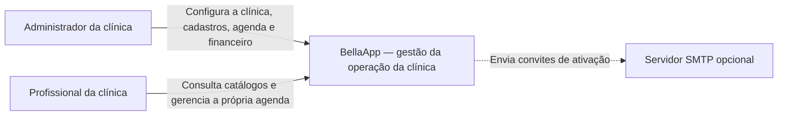
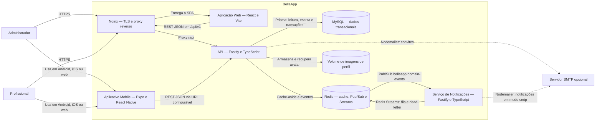
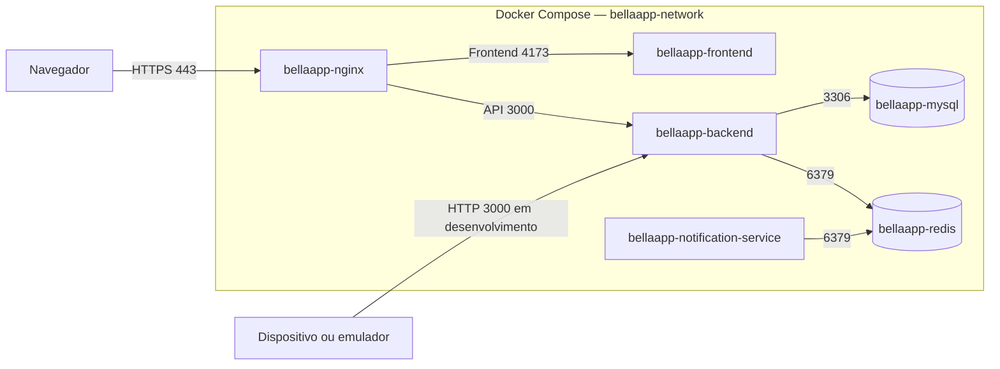

# C4 — Contexto e Contêineres

Data da revisão: 10/11/2026 (inclui o serviço de notificações).

## Convenções

- **Pessoa:** ator que interage diretamente com o produto.
- **Sistema:** fronteira funcional completa do BellaApp.
- **Contêiner:** unidade executável ou armazenamento implantável.
- Setas identificam protocolo e intenção da relação.

O cliente da clínica é uma entidade do domínio, mas não aparece como pessoa no
C4 porque o produto atual não oferece uma área autenticada para ele.

## Nível 1 — Contexto do sistema

### Relações do contexto

| Origem | Destino | Relação |
|---|---|---|
| Administrador | BellaApp | Administra conta, clínica, clientes, serviços, profissionais, salas, agenda, plano e caixa |
| Profissional | BellaApp | Acessa os catálogos permitidos e apenas os agendamentos/caixa do próprio vínculo |
| BellaApp | SMTP | Envia convite de ativação quando `MAIL_DELIVERY_MODE=smtp`; em desenvolvimento pode apenas registrar o link em log |

## Nível 2 — Contêineres

## Responsabilidades dos contêineres

| Contêiner | Tecnologia | Responsabilidade | Interface |
|---|---|---|---|
| Nginx | `nginx:alpine` | Encerrar TLS local, redirecionar HTTP para HTTPS, servir como entrada única do web e encaminhar `/api/` | 80 e 443 no host |
| Aplicação Web | React 19, Vite 8 | Interface completa de administração, agenda, clientes, serviços, profissionais, salas, planos, cobranças/caixa e perfil | Vite Preview em 4173, somente rede Docker |
| Aplicativo Mobile | Expo 54, React Native | Interface móvel para autenticação, onboarding, início, agenda e cadastros; usa a mesma API | `EXPO_PUBLIC_API_URL` ou host de desenvolvimento |
| API | Fastify 5, TypeScript | Autenticação/autorização, regras de negócio, validação, cache, eventos, persistência e arquivos | REST `/api/v1`, porta 3000 em desenvolvimento |
| MySQL | MySQL LTS | Fonte de verdade transacional e multiclínica | 3306 na rede Docker; 3307 local pelo override |
| Redis | Redis 7 | Cache distribuído com TTL/invalidação, canal Pub/Sub de eventos e Streams da fila de notificações | 6379 apenas na rede Docker |
| Serviço de Notificações | Fastify 5, TypeScript, Redis Streams | Processo independente: assina eventos de domínio, enfileira notificações, entrega com até 3 tentativas e envia falhas definitivas para a dead-letter | `POST /api/v1/notifications` e `GET /health`, porta 3001 |
| Volume de imagens | Volume Docker | Persistência dos avatares enviados | Montado em `/app/uploads` no backend |
| SMTP | Provedor configurável | Entrega de e-mails de convite e de notificações; pode ser substituído por modo de log | SMTP configurado por ambiente |

## Fluxos arquiteturais principais

### Requisição autenticada

1. Web ou mobile envia `Authorization: Bearer <access-token>`.
2. O Fastify valida o JWT e confirma que a sessão de refresh ainda existe.
3. `UserClinicContextService` resolve clínica, papel, plano e profissional.
4. O módulo aplica regras e filtra todas as consultas pelo `clinicId`.
5. A resposta inclui `X-Request-Id` para correlação com os logs.

### Leitura com cache

1. O serviço monta a chave com namespace, clínica, papel/profissional, versão e
   hash dos filtros.
2. Em hit, devolve o JSON do Redis.
3. Em miss, consulta o repositório Prisma, responde e grava com TTL.
4. Se o Redis falhar durante a requisição, a leitura continua pelo MySQL.

### Mutação e evento

1. O service valida a regra e persiste no MySQL.
2. Incrementa a versão dos namespaces de cache afetados.
3. Publica um envelope no canal `bellaapp:domain-events`.
4. O subscriber valida o envelope e registra publicação, recebimento e
   processamento com o mesmo `eventId`.
5. O serviço de notificações, assinante do mesmo canal, converte eventos de
   agendamento e pagamento em jobs na stream `bellaapp:notifications`.
6. O worker do consumer group entrega o job. Em falha, reenfileira até a
   terceira tentativa e depois move o job para
   `bellaapp:notifications:dead-letter` (ver [ADR-0005](adr/0005-notificacoes-redis-streams.md)).

## Implantação local

MySQL, Redis, backend, frontend e notification-service possuem health checks. O
backend aguarda MySQL e Redis saudáveis; o notification-service aguarda o Redis;
o frontend aguarda o backend; o Nginx aguarda frontend e backend. Em
desenvolvimento, o override publica o notification-service na porta 3001. O Nginx foi validado externamente pelo endpoint HTTPS de saúde.
