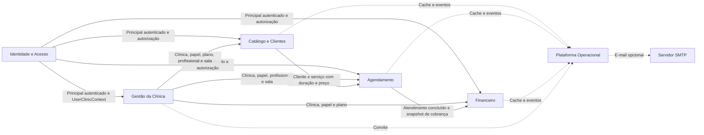
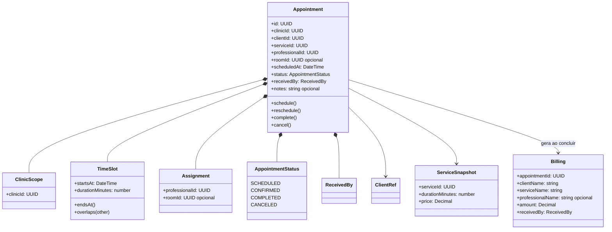

# DDD — Context Map, Bounded Contexts e modelo de domínio

Data da revisão: 05/11/2026.

## Escopo e nível de adoção

O BellaApp adota DDD como ferramenta de análise e de organização do monólito
modular. Os contextos abaixo são **fronteiras lógicas**: todos são executados no
mesmo processo Fastify e persistem no mesmo schema MySQL. Portanto, o diagrama
não afirma que existem microserviços ou bancos independentes.

## Domínio e subdomínios

| Classificação | Subdomínio | Motivo |
|---|---|---|
| Core | Agendamento | Concentra disponibilidade, conflitos de horário, ciclo de vida do atendimento e passagem para cobrança; é o principal diferencial operacional |
| Suporte | Gestão da Clínica | Mantém tenant, membros, papéis, profissionais, salas, onboarding e limites do plano |
| Suporte | Catálogo e Clientes | Mantém clientes e serviços usados pela agenda, inclusive duração e preço |
| Suporte | Financeiro | Materializa cobranças de atendimentos e controla caixa e movimentos |
| Genérico | Identidade e Acesso | Login, tokens, sessão e recuperação de identidade autenticada |
| Genérico | Plataforma Operacional | Cache, eventos, health check, arquivos, logs e entrega de e-mail |

## Linguagem ubíqua

| Termo | Significado no BellaApp |
|---|---|
| Clínica | Tenant que possui e isola os dados operacionais |
| Vínculo | Associação de um usuário a uma clínica, papel e, quando aplicável, profissional |
| Profissional | Pessoa habilitada a executar o serviço e possuir agenda |
| Cliente | Pessoa atendida pela clínica; não é um usuário autenticado do produto atual |
| Serviço | Item do catálogo com duração e preço |
| Sala | Recurso físico opcional alocado ao agendamento |
| Agendamento | Compromisso de cliente, serviço, profissional, horário e sala opcional |
| Atendimento concluído | Agendamento no estado `COMPLETED`, protegido contra alterações estruturais |
| Cobrança | Snapshot financeiro idempotente gerado a partir de um atendimento concluído |
| Caixa | Período de operação financeira com entradas, saídas e saldo |

## Context Map

## Relacionamentos entre contextos

| Upstream | Downstream | Padrão e contrato atual |
|---|---|---|
| Identidade e Acesso | Contextos de negócio | **Open Host Service / Published Language:** JWT validado e `UserClinicContext` com `clinicId`, papel, plano e `professionalId` |
| Gestão da Clínica | Catálogo, Agendamento e Financeiro | **Customer–Supplier:** os consumidores usam o escopo e as referências mantidas pela clínica |
| Catálogo e Clientes | Agendamento | **Customer–Supplier:** Agendamento consulta cliente e serviço; duração participa do conflito e preço entra no snapshot financeiro |
| Agendamento | Financeiro | **Anticorruption Layer local:** `buildBillingSnapshot` traduz o modelo detalhado de agenda para o contrato aceito por `ensureForCompletedAppointment` |
| Contextos de negócio | Plataforma Operacional | **Published Language:** envelopes de eventos com tipo, clínica, agregado, ator, data e metadados; cache usa namespace e escopo canônicos |

Como há um schema compartilhado, relações Prisma permitem navegação direta entre
modelos. Services e repositories funcionam como a fronteira de aplicação; uma
evolução para serviços independentes exigiria substituir essas consultas por
contratos remotos ou eventos duráveis.

## Bounded Contexts e responsabilidades

| Bounded Context | Responsabilidades | Módulos atuais |
|---|---|---|
| Identidade e Acesso | Cadastro/login, JWT, refresh token, convites e resolução do usuário autenticado | `auth`, `users`, `shared/auth` |
| Gestão da Clínica | Onboarding, perfil da clínica, membros, profissionais, salas e restrições de plano | `onboarding`, `professionals`, `rooms`, `billing`, partes de `users` |
| Catálogo e Clientes | Cadastro e consulta de clientes e serviços dentro da clínica | `clients`, `services` |
| Agendamento | Criar, listar, alterar, concluir e excluir agendamentos; validar escopo, agenda e ciclo de vida | `appointments` |
| Financeiro | Cobranças derivadas de atendimentos e abertura, movimentação e fechamento de caixa | `billings`, `cash` |
| Plataforma Operacional | Saúde, cache, Pub/Sub, logs, tratamento de erros, imagens e e-mail | `health`, `profile-images`, `shared/cache`, `shared/events`, `lib`, `config` |

As fronteiras foram escolhidas por vocabulário, regras e ritmo de mudança. Por
exemplo, alterar preço de um serviço não reescreve uma cobrança histórica,
porque Financeiro recebe um snapshot. Já duração do serviço pertence ao
Catálogo, mas é consultada por Agendamento no momento de detectar conflito.

## Modelo do domínio de Agendamento

Agendamento foi escolhido para o modelo detalhado porque concentra as regras
mais importantes e coordena Catálogo, Gestão da Clínica e Financeiro.

### Agregados, entidades e Value Objects

- **Raiz do agregado de Agenda:** `Appointment`. Alterações de horário, estado,
  profissional e sala passam por `AppointmentsService`.
- **Agregados referenciados:** Cliente, Serviço, Profissional e Sala mantêm ciclo
  de vida próprio. O Agendamento guarda seus IDs; eles não são entidades filhas
  do agregado.
- **Agregado Financeiro:** `Billing` é separado e possui vínculo único com o
  agendamento. É criado idempotentemente na mesma transação que conclui o
  atendimento.
- **Value Objects conceituais:** `ClinicScope`, `TimeSlot`, `Assignment`,
  `AppointmentStatus` e `ReceivedBy`. No código atual eles aparecem como DTOs
  validados, enums Prisma e tipos primitivos, e não como classes TypeScript.
- **Snapshot:** ao concluir, nomes, preço, data, profissional e forma de
  recebimento são copiados para Cobrança para preservar o histórico.

### Invariantes verificadas pelo código

1. Todo acesso usa o `clinicId` do vínculo autenticado; referências de outra
   clínica são tratadas como inexistentes.
2. Um agendamento precisa de profissional e não pode ser criado no passado.
3. Cliente, serviço, profissional e sala informados precisam existir na mesma
   clínica.
4. Intervalos de estados `SCHEDULED` e `CONFIRMED` não podem se sobrepor para o
   recurso consultado. A duração vem do Serviço; quando há sala, o conflito é
   limitado pela sala, caso contrário pelo profissional.
5. Um profissional só consulta e altera os próprios agendamentos.
6. Agendamento cancelado não pode ser concluído.
7. Atendimento concluído não volta de estado nem altera cliente, serviço,
   horário, profissional ou sala; apenas campos não estruturais permanecem
   elegíveis conforme o caso de uso.
8. Conclusão e criação da cobrança ocorrem na mesma transação Prisma. Repetir a
   conclusão não duplica a cobrança.
9. Agendamento associado a cobrança não pode ser excluído.
10. Após commit, mutações invalidam caches relacionados e tentam publicar um
    evento; falha do Redis não desfaz a transação de negócio.

## Mapeamento do modelo para o código

| Conceito | Evidência |
|---|---|
| Raiz, regras e ciclo de vida de Agendamento | `backend/src/modules/appointments/appointments.service.ts` |
| Persistência e busca de conflitos | `backend/src/modules/appointments/appointments.repository.ts` |
| Contrato e validação de entrada | `backend/src/modules/appointments/appointments.schemas.ts` e `appointments.dtos.ts` |
| Modelos, enums, relações e unicidade da cobrança | `backend/prisma/schema.prisma` |
| Tradução Agenda → Financeiro | `buildBillingSnapshot` e `billingsService.ensureForCompletedAppointment` |
| Escopo da clínica e profissional | `backend/src/shared/auth/user-clinic-context.ts` e helpers de escopo |
| Invalidação e evento pós-mutação | `recordMutation` em `appointments.service.ts` |
| Casos de sucesso e violações de invariantes | `appointments.service.spec.ts` e `appointments.repository.spec.ts` |

## Exemplo para apresentação

### Criar agendamento

1. O controller recebe cliente, serviço, profissional, sala opcional, horário e
   estado já validados pelo schema.
2. Identidade e Acesso resolve o `UserClinicContext`; profissional autenticado
   fica restrito ao próprio `professionalId`.
3. O service exige data futura e busca todas as referências com `clinicId`.
4. O repository lê compromissos do dia e o service compara intervalos usando a
   duração do serviço.
5. Sem conflito, o agregado é persistido no MySQL.
6. Após o commit, os namespaces afetados são invalidados e
   `appointment.created` é publicado no Redis Pub/Sub.

### Concluir atendimento

1. O service bloqueia um agendamento cancelado e confirma propriedade/tenant.
2. Dentro de uma transação, marca `COMPLETED`, monta o snapshot e solicita ao
   Financeiro a cobrança idempotente.
3. A transação retorna Agendamento e Cobrança consistentes.
4. Depois do commit, ocorre invalidação e publicação de
   `appointment.completed`.

## Limitações e evolução

- O agregado é protegido pelo service, não por métodos de uma classe rica; uma
  futura refatoração pode encapsular `TimeSlot` e transições de estado sem mudar
  o contrato HTTP.
- A checagem de conflito é feita antes da escrita e não substitui controle de
  concorrência no banco. Para alta disputa, considerar lock transacional ou
  restrição/serialização específica.
- Redis Pub/Sub não é adequado para integração financeira obrigatória. A
  transação local garante a cobrança atual; integrações externas futuras devem
  adotar Outbox e consumidor idempotente.
- O banco compartilhado facilita transações atuais, mas reduz autonomia dos
  contextos. Separar persistência só se justifica quando houver necessidade
  real de escala, implantação ou propriedade independente.
